  <picture>
    <source media="(max-width: 600px)" srcset="./banner-mobile.svg" />
    
  </picture>

  <picture>
    <source media="(max-width: 600px)" srcset="./blank.svg" />
    
  </picture>
  

  
  
  
  

